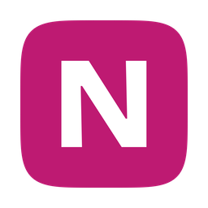
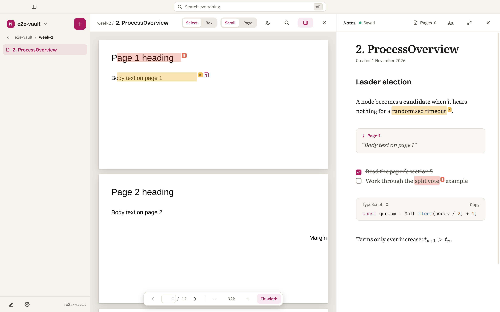
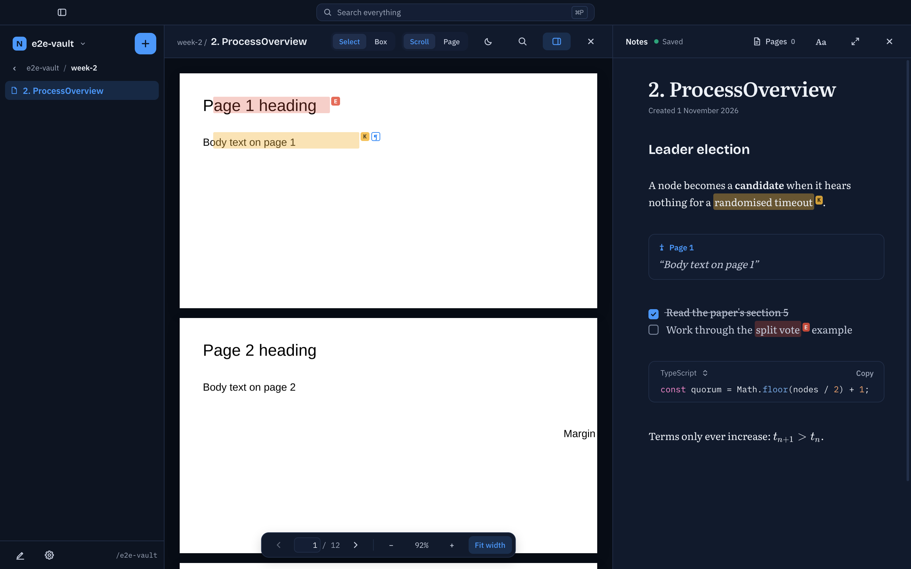
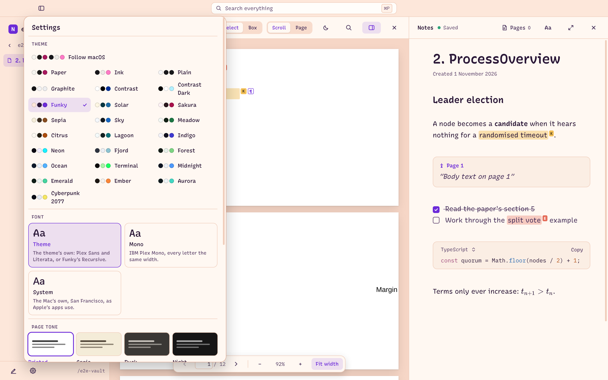
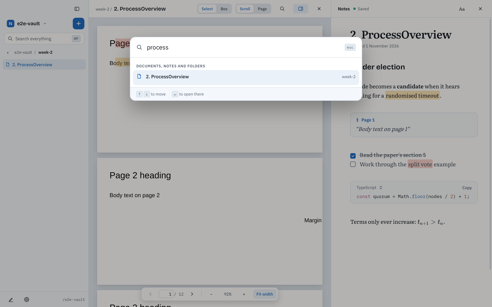

<p align="center">
  
</p>

# Nexus

**A local-first macOS app for Markdown notes — on their own, or beside the documents they are about.**

Keep plain notes in folders, or open a PDF, slide deck or handout on the left with its notes
on the right, tied together: highlight a sentence on a page, press **Link to notes**, and a
citation lands in your notes that jumps back to that exact spot. Everything is plain files
in a folder you choose. Nothing leaves your Mac.

> **Status:** in active development (version 0.1.0). It is built for one person's own use
> and is not a released product. See [What works today](#what-works-today) and
> [Not built yet](#not-built-yet) for an honest picture.



<table>
  <tr>
    <td></td>
    <td></td>
  </tr>
  <tr>
    <td align="center">Midnight, one of the dark themes. The page stays white.</td>
    <td align="center">Twenty-four themes, chosen in Settings.</td>
  </tr>
  <tr>
    <td></td>
    <td></td>
  </tr>
  <tr>
    <td align="center">⌘P searches documents, notes and folders.</td>
    <td></td>
  </tr>
</table>

The screenshots use the test suite's sample vault, not real notes. They are retaken with
`npx playwright test -c scripts/screenshots/screenshots.config.ts`.

---

## Principles

- **Offline, always.** No accounts, no telemetry, no network requests. Fonts, the PDF
  engine, KaTeX, Mermaid and Chart.js are all bundled. The Content Security Policy blocks
  outside connections.
- **Your files, readable without Nexus.** A vault is an ordinary folder. Notes are Markdown,
  highlights are JSON, and every document is kept as a PDF next to its original.
- **Never lose work.** Every write is atomic (temp file → `fsync` → rename). A file that
  fails to parse is backed up, not discarded. Notes edited elsewhere while open are flagged
  as a conflict, not overwritten.
- **Private by construction.** Logs hold error codes and timings only. Nothing you typed or
  named, not even a file path, is ever written to them.

## What works today

**Vault**
- Open any folder as a vault. Its folders nest up to five levels deep.
- The sidebar shows **one folder at a time**: step into a folder, back out with the arrow or
  the breadcrumb. Whatever you add goes into the folder showing, so nothing needs filing.
- **Plain notes**: `+ Note` makes a note with no document beside it, written full width.
- `+ Folder` makes a folder; the edit panel moves an item to another one, taking its notes,
  highlights and remembered place with it.
- Search everything with `⌘P`: a window listing names, lines of notes and highlights from
  every folder, each saying where it is. `↑`/`↓` to choose, `↵` to open at that place.
- A **Highlights library** of every highlight in the vault, filterable by meaning, folder
  and words — "every exam point in Week 3".
- Import with `Import…`, the file picker (`⌘O`) or by dropping files on the window. PDFs are
  used as they are; PPT, PPTX, DOC and DOCX are converted to PDF once, at import, by
  LibreOffice when it is installed. The original is always kept.
- Each item can have a **number**, taken from a document's file name at import
  (`2. Process.pdf` is number 2, "Process") and editable; numbers order a folder's items.
- Edit an item's title, number, tags and folder in a side panel.
- Delete an item from the same panel. It moves, whole, to the vault's hidden `.trash`
  folder; drag it back out in Finder to restore it.

**Reading**
- PDF rendering with pdf.js, in continuous-scroll or one-page mode. Pages and zoom float at
  the foot of the document: arrows, a page field, zoom and fit-width.
- Each document and note reopens where you left it, and Nexus reopens the last one on launch.
- Find in the open document (`⌘F`): every match marked, Enter for the next.
- Text highlights in four meanings: **K**ey concept (amber), **D**efinition (green),
  **E**xam (red), **Q**uestion (blue). Each carries its letter as well as its colour.
- Area highlights around diagrams and equations: hold **Option** and drag, or use the box tool.
- Sticky notes on a slide, which can be dragged, resized, reworded and cited.
- Undo and redo for all of the above (`⌘Z` / `⌘⇧Z`).

**Notes**
- A Markdown editor (CodeMirror 6) with live preview in the same view: headings, lists,
  tables, task lists, quotes, and code blocks with syntax colouring for JavaScript,
  TypeScript, CSS, HTML and JSON.
- LaTeX through KaTeX, `mermaid` diagrams, and declarative `chart` blocks. A broken block
  shows a hint inline and never takes the editor down.
- Paste or drop images. They are saved into the item's `assets/` folder.
- A Notion-style format bar over a selection, or docked open from the notes' **Aa** button
  to choose a format before writing; shortcuts too, plus highlighting in the notes in the
  same four meanings.
- Markdown underneath, never on screen: `# ` makes a heading and disappears, as in Notion.
  Copying gives the Markdown.
- Notion-style handles: hover a line for `+` (add a line below) and `⋮⋮` (drag to move it,
  or click for Delete, Duplicate and Turn into); headings appear as dashes down the right
  edge, to jump between.
- Citations and images are elements: kept or removed whole. Typing ``` opens a code block
  to write in.
- To-dos are drawn as boxes; a done one is struck through.
- Saves as you type. The divider between document and notes can be dragged, and so can the
  sidebar's edge; both widths are remembered on this Mac.

**Linking**
- **Link to notes** saves the highlight and inserts a citation at your cursor:
  `> 📌 **[Page 4](cite://<id>)**: *"…the sentence you highlighted…"*`
- Clicking a citation scrolls the document to the highlight and pulses it.
- A highlight that is cited shows a ¶ marker; clicking it scrolls the notes to the citation.

**Look**
- Twenty-four themes in every colour — Paper, Ink, Plain, Graphite, Contrast, Contrast
  Dark, Funky, Solar, Sakura, Sepia, Sky, Meadow, Citrus, Lagoon, Indigo, Neon, Fjord,
  Forest, Ocean, Terminal, Midnight, Emerald, Ember and Aurora — or follow macOS between
  Paper and Ink, chosen in Settings (the gear at the foot of the sidebar). Every one is
  contrast-tested, and the page stays white in all of them. Where a theme's accent would
  clash with a highlight colour, that highlight takes another colour in that theme; its
  letter (K/D/E/Q) stays.

**Diagnostics**
- An error panel (`⌘0`, or Settings → Errors since launch) lists every error shown since
  launch, each with a code and a plain sentence saying what to do. The Settings gear
  shows a dot when there have been any.

## Not built yet

Recorded in [`PROGRESS.md`](./PROGRESS.md) with the reasoning for each:

- Remembering zoom per document (the page and position are remembered; zoom is not yet).
- Page thumbnails, the document outline, Fit page, `⌘+` / `⌘−` zoom.
- `⌘L`, `⌘B`, and `⌘\` split presets (today `⌘\` shows or hides the notes).
- Renaming, deleting or moving a folder, and dragging items between folders (Finder does
  these meanwhile; Nexus picks the change up when the vault is next read).
- The "Reorganize vault" screen (the engine exists; it files by course and week, which the
  window no longer asks for).
- The rest of the diagnostics drawer: past logs, converter output, timings.
- Telling you when LibreOffice is missing (imports wait safely until it is installed).
- Restyling parts of the UI from the approved design canvas.

## Keyboard shortcuts

| Shortcut | Action |
|---|---|
| `⌘O` | Import a document |
| `⌘P` | Search window: names, notes and highlights in every folder |
| `⌘F` | Find in the open document |
| `⌘\` | Show or hide the notes |
| `⌘Z` / `⌘⇧Z` | Undo / redo highlights and sticky notes (in the notes: your typing) |
| `⌘0` | Error panel |
| **Option**-drag | Area highlight |
| `⌘B` `⌘I` `⌘⇧S` `⌘E` `⌘K` | Bold, italic, strikethrough, code, link (in the notes) |
| `⌘⌥1`–`3` / `⌘⌥4`–`6` | Headings / bulleted, numbered, to-do list (in the notes) |
| `⌘⇧H` | Highlight in the notes |

## How a vault is stored

```text
StudyVault/
├── .nexus/                    # Derived cache only — safe to delete, rebuilt by a scan
├── Journal/                   # An ordinary folder
│   └── monday-plans/          # A plain note: no document beside it
│       ├── manifest.json
│       ├── notes.md
│       └── assets/
└── CS454/
    └── 02-raft-consensus/     # A document with its notes
        ├── manifest.json      # Title, number, tags, order, where the document came from
        ├── source/
        │   ├── original.pptx  # The file you imported, kept for reconversion
        │   └── document.pdf   # What the viewer renders
        ├── notes.md           # Markdown with cite://<id> links
        ├── annotations.json   # Highlights and sticky notes, in page-relative coordinates
        └── assets/            # Images pasted or dropped into the notes
```

- **An item is any folder holding a `manifest.json`**; every other folder is just a folder.

- **Highlight positions are fractions of the page** (`0.0`–`1.0` of the unscaled page), so
  they land in the same place at any zoom, on any screen, and on a future iPad app.
- **Everything inside a bundle is relative**, so an item's folder can be moved or synced
  without rewriting anything.
- **Per-device state stays off the vault.** Theme and notes width live in
  `~/Library/Application Support/Nexus/`. A sync client therefore never sees them.

## Architecture

```text
crates/
├── lecture-core     Pure Rust domain logic: no Tauri, no UI, no platform code.
│                    Compiles for aarch64-apple-ios, checked on every gate run.
├── lecture-fs       Filesystem adapters: atomic storage, stores, vault scan, logging.
├── lecture-convert  Optional LibreOffice converter behind DocumentConverterPort.
└── src-tauri        Thin IPC adapter (the `nexus-app` crate). No business logic.
src/
├── ipc/             Typed wrappers for every command; every payload validated with Zod.
├── pdf/             Page geometry, selection and coordinate maths.
├── notes/           Markdown rules: citations, formatting, live-preview widgets.
└── ui/              React components and hooks; stylesheets in ui/styles/.
e2e/                 Playwright journeys in WebKit, against a mocked backend.
fixtures/            Contract fixtures written by Rust, read by TypeScript tests.
```

The stack is Tauri 2, Rust 1.97, React 19, TypeScript 6 (strict), Vite, CodeMirror 6 and
pdf.js. Desktop-only capabilities are ports (traits) in `lecture-core` with adapters
elsewhere. That keeps the domain portable to the planned iPadOS companion app.

## Install the app

Nexus builds to a standard macOS disk image (`.dmg`). There is no published download yet;
build one yourself with `npm run app:build` (see below), or get one from whoever built it.

1. Open `Nexus_0.1.0_aarch64.dmg` and drag **Nexus** into **Applications**.
2. Open Nexus from Applications. The first time, macOS will refuse, saying it cannot check
   the app for malicious software. Go to **System Settings → Privacy & Security**, scroll to
   the message about Nexus, and choose **Open Anyway**. macOS remembers the choice.
3. Choose **Open a vault** and pick a folder for your notes. An empty folder is fine.

The disk image is built for **Apple silicon** (M1 and later). On an Intel Mac, build from
source instead.

### Why macOS warns about it

Apple trusts an app without asking when it is signed with a **Developer ID certificate** (part
of the paid Apple Developer Program) and **notarized**, meaning Apple has scanned it. Nexus is
built with a free *ad-hoc* signature instead. That keeps the app intact and identifiable, but
does not tell Gatekeeper who made it, so macOS asks you to confirm once. Removing the
prompt for everyone would need a Developer ID and notarization added to the build. See
[Distributing](#distributing).

## Set up locally (from source)

You need a Mac. These steps take a fresh machine to a running development build.

1. **Xcode Command Line Tools** (the compiler and macOS SDK):
   ```sh
   xcode-select --install
   ```
2. **Rust**, through rustup (<https://rustup.rs>):
   ```sh
   curl --proto '=https' --tlsv1.2 -sSf https://sh.rustup.rs | sh
   ```
   You do not choose a version. `rust-toolchain.toml` pins Rust 1.97.0 with the iOS target,
   and rustup installs exactly that the first time you build.
3. **Node.js 22**, from <https://nodejs.org> or with Homebrew (`brew install node@22`).
4. **The code and its packages:**
   ```sh
   git clone https://github.com/stereogon/nexus.git
   cd nexus
   npm ci
   ```
5. **Run it:**
   ```sh
   npm run app
   ```
   The first build compiles the Rust side and takes a few minutes; later starts are quick.
   A window opens. Choose **Open a vault** and pick a folder.

**Use a throwaway vault while developing:** a new folder with a PDF or two in it. A
development build writes real files.

Optional extras:

| For | Install |
|---|---|
| Importing PPT, PPTX, DOC and DOCX | `brew install --cask libreoffice` |
| Running the end-to-end tests | `npx playwright install webkit` |

### Build the app and disk image

```sh
npm run app:build
```

When it finishes:
- `target/release/bundle/macos/Nexus.app` is the app
- `target/release/bundle/dmg/Nexus_0.1.0_aarch64.dmg` is the disk image to share

The build is for the Mac it runs on (`aarch64` on Apple silicon).

### Check it

```sh
./scripts/gate.sh
```

The gate is the project's definition of done, and CI runs the same script. It runs:
- `cargo fmt --check`, `cargo test`, `cargo clippy -D warnings`
- the iOS compile check of `lecture-core`
- `npm run typecheck`, `npm run lint`, `npm run test`, `npm run build`
- the LibreOffice end-to-end tests (when LibreOffice is installed)
- the Playwright suite (when WebKit is installed)
- the 300-line file limit

Every step runs even if one fails, so you see everything that is broken at once.

## Distributing

There are three ways to get Nexus to someone else:

| Way | What they need to do | Cost |
|---|---|---|
| **Source** | Follow [Set up locally](#set-up-locally-from-source) | None |
| **The `.dmg`, as built today** | Install, then approve it once under Privacy & Security | None |
| **A signed and notarized `.dmg`** | Install and open, with no warning | Apple Developer Program, US$99 a year |

A `.dmg` belongs on a **GitHub Release**, not in the repository, because a binary in git
history bloats every clone forever. The Mac App Store is not planned: it requires
sandboxing, and Nexus needs to read the vault folder you choose and to run LibreOffice.

## Documentation

| File | What it holds |
|---|---|
| [`CONTRIBUTING.md`](./CONTRIBUTING.md) | How to work on Nexus: setup, standards, the definition of done |
| [`claude-spec.md`](./claude-spec.md) | The product specification, with dated amendments where it changed |
| [`PROGRESS.md`](./PROGRESS.md) | Milestones, the decision log, known gaps, and every dependency's licence |
| [`CLAUDE.md`](./CLAUDE.md) | The binding rules for AI assistants working in this repository |

## Licence

No licence has been chosen for Nexus yet, so all rights are reserved by default. Every bundled
font, crate and package has its licence recorded in [`PROGRESS.md`](./PROGRESS.md#5-licences).
All fonts are under the SIL Open Font License.
